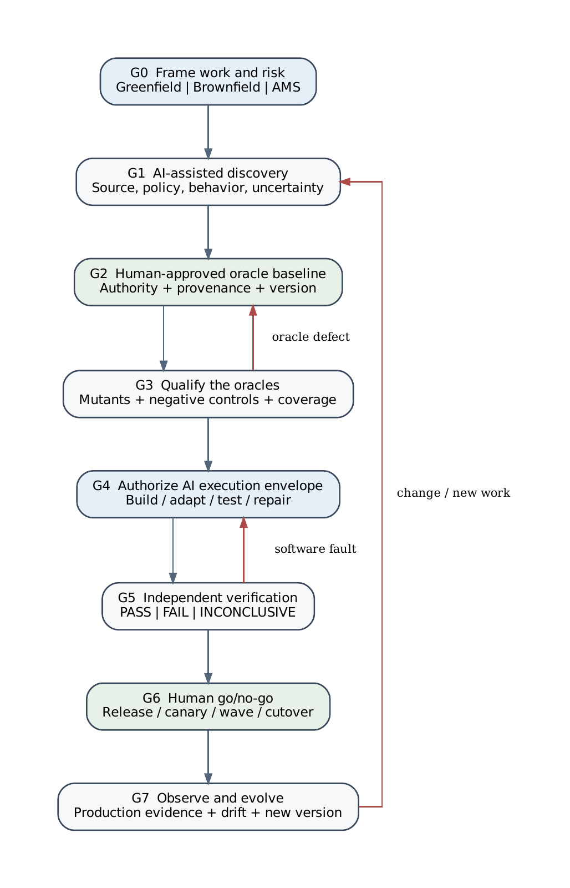
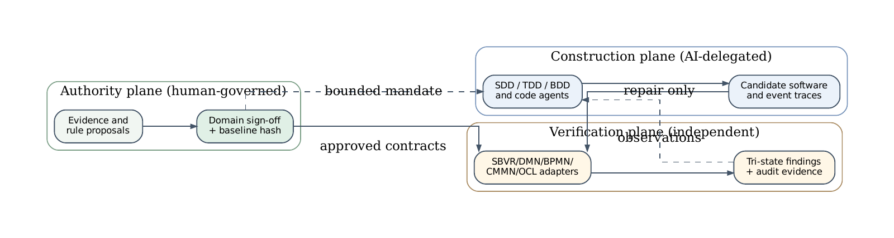

# TODM: A Test Oracle-Driven Methodology for Human-Governed AI Software Engineering

**Version:** 2.0 editorial draft · **Date:** 16 November 2026

Editorial revision; no new empirical results. [PDF](TODM_Paper_v2.0.pdf) · [LaTeX](source/v2.0.tex) · [Supplement](TODM_Supplement_v2.0.md)

## Abstract

Coding agents can generate specifications, implementations, and tests from the same mistaken interpretation of a business rule. Agreement between these artifacts therefore does not establish correctness. The Test Oracle-Driven Methodology (TODM) addresses this shared-error problem by separating human approval of expected behavior, delegated construction, and independent verification. It combines a versioned oracle baseline, eight lifecycle gates, mutation-based oracle qualification, and PASS, FAIL, or INCONCLUSIVE verdicts. Five established modeling families provide risk-selected behavioral contracts rather than mandatory engines. A worked example explains the method; a synthetic companion artifact exercises selected acceptance controls. We distinguish those engineering checks from a proposed comparative evaluation across greenfield development, brownfield modernization, and maintenance. The contribution is a specified composition of established techniques with explicit authority and evidence boundaries. Comparative effectiveness, industrial generalization, and production enforcement remain unproven.

**Keywords:** test oracle problem; AI software engineering; model-based testing; human oversight; agent governance.

# Introduction

Agentic coding systems support specification, implementation, testing, and repair, but still require a basis for deciding whether observed behavior is correct. The test oracle problem is established in software engineering (Barr et al. 2015). Agent-assisted development makes one failure mode particularly relevant: software and its acceptance tests may inherit the same erroneous specification. More generated tests need not expose that shared premise.

TODM addresses the gap between consistency with generated artifacts and conformance to independently approved business behavior. It requires an accountable source of expected outcomes, executable evaluators, and evidence binding each verdict to an approved baseline and candidate. Agents may propose rules and repairs, but cannot unilaterally approve the standard against which their work is judged.

The proposed contributions are an operational oracle-baseline definition; an eight-gate lifecycle with recovery paths; separate authority, construction, and verification responsibilities; qualified, three-valued acceptance controls; and a falsifiable evaluation protocol. Separating action authorization from output correctness is part of this composition. These are methodological contributions, not claims to have invented their constituent techniques or demonstrated superiority.

Section 2 positions the proposal against related work. Section 3 defines TODM, and Section 4 follows one illustrative error. Section 5 describes the synthetic artifact and inherited acceptance report; Section 6 sets out future empirical evaluation. Sections 7 and 8 discuss limitations and conclude with future work. Operational detail is retained in the accompanying v2.0 supplement.

# Background and Related Work

Barr et al.’s 2015 survey synthesizes long-standing oracle techniques, including specifications, models, contracts, and metamorphic relations (Barr et al. 2015). Mutation testing deliberately injects faults to evaluate whether tests can distinguish faulty variants (Jia and Harman 2011); metamorphic testing checks relations between executions when individual expected outputs are difficult to specify (Segura et al. 2016). TODM relies on these precedents. It does not claim to invent test oracles, model-based testing, human approval, or mutation testing.

Specification-driven development structures the path from intent to implementation; modern tooling such as GitHub Spec Kit includes specification, planning, tasks, implementation, and convergence as well as optional consistency controls (GitHub 2026). Test-driven development and behavior-driven development help developers express and exercise expected outcomes; Gherkin offers a common language for executable examples (Cucumber, n.d.). TODM is *complementary*: a vetted specification or example can itself become an oracle. The method’s additional requirement is independent authority over the behavioral contract, explicit qualification of its defect-detection ability, and sustained verification against system observations. It would be inaccurate to argue that SDD, TDD, or BDD inherently prevent such controls; their implementations can incorporate them.

Legacy characterization tests document observed behavior, helping engineers change unfamiliar systems (Feathers 2004). Yet observation does not prove business correctness: historical defects may be copied into a replacement system. Incremental replacement patterns, such as the Strangler Fig approach, offer deployment choices rather than a comprehensive theory of behavioral truth (Fowler 2004). TODM separates normative requirements, observed legacy behavior, and machine-inferred hypotheses and permits incremental or single-cutover delivery.

The Object Management Group publishes standard descriptions for business processes (BPMN), cases (CMMN), decisions (DMN), business rules and vocabulary (SBVR), and constraints (OCL) (Object Management Group 2014a, 2016, 2024, n.d., 2014b). Existing engines, including Flowable, execute significant BPMN, CMMN, and DMN subsets (Flowable 2026). TODM therefore specifies *adapters and supported semantic profiles*, not five novel universal standards implementations. A Mermaid diagram, JSON document, or YAML file is not automatically an OMG-compliant execution model. Model syntax, version, supported constructs, and runtime behavior must be declared.

The constituent techniques are established; this paper does not substantiate global architectural novelty or the absence of competing methodologies. The specific research contribution is an *explicitly specified methodological composition*: a human-authorized oracle baseline; evaluator separation from generation; mutation-qualified oracles; tri-state decisions with evidence; and controlled delegation with reusable lifecycle gates across greenfield, brownfield, and application management. Distinctiveness is a hypothesis open to comparative study and prior-art challenge.

# The TODM Methodology

## Core concepts

**Definition 1** (Behavioral oracle). *A behavioral oracle is the tuple $`o=(id, v, r, a, i, e, s, c)`$, where $`id`$ identifies the control, $`v`$ its version, $`r`$ the approved behavioral rule, $`a`$ the accountable approving authority, $`i`$ required inputs and observations, $`e`$ an evaluator with declared semantics, $`s`$ its severity and scope, and $`c`$ its provenance and supporting evidence. A textual rule without an evaluator or observable binding is an *oracle candidate*, not an executable oracle.*

**Definition 2** (Oracle baseline). *An approved oracle baseline $`B_v=\{o_1,\dots,o_n\}`$ is a uniquely versioned and integrity-protected collection of approved oracles, together with model profiles, required evidence, owner decisions, and an immutable release manifest. Integrity protection may use cryptographic hashes and digitally recorded approvals; it does not prove a rule semantically correct.*

**Definition 3** (Construction mandate). *A construction mandate $`M`$ defines the scope and permitted operations of delegated agents, execution environments, allowed dependencies, escalation conditions, change boundaries, and the baseline version against which the candidate must be evaluated. The mandate grants engineering autonomy but never the right to approve a new baseline.*

Evidence is classified as NORMATIVE (approved policy), OBSERVED (system behavior), or INFERRED (machine-derived hypothesis). Conflicting rules require adjudication; historical behavior is not automatically correct. Every critical rule needs ownership, provenance, and an uncertainty record.

## Lifecycle and recovery paths

Figure [1](#fig:method) presents a process of evidence-controlled activities, not a deployment architecture. Gates can overlap in time, but authority and baseline constraints apply throughout. The detailed input/output inventory is in the supplement.

<a id="fig:method"></a>



*The eight TODM gates and principal rework loops. Reverse transitions are deliberate, not methodological failures.*

**G0–G1: Frame and discover.**

Define the capability, accountable owner, observable scope, risks, and evidence access. Extract rules from policies, code, data, traces, and interviews as available. Record conflicts and critical unknowns with owners and stop conditions; model confidence is not approval.

**G2: Approve the baseline.**

Translate reviewed rules into typed contracts with versions, effective dates, supported semantics, required observations, and ownership. Approval binds the exact baseline. Later changes require a new reviewed version.

**G3: Qualify the oracles.**

Exercise correct controls, boundaries, seeded faults, missing observations, and evaluator failures. All designated critical seeded violations must be detected, correct controls must pass, and incomplete evidence must remain inconclusive. Contract defects return to G2; evaluator defects return to qualification.

**G4: Construct within a mandate.**

Agents implement, test, and repair within approved scope, using SDD, TDD, BDD, or other engineering practices. Preserve reproducible builds, source and dependency versions, observations, and execution logs. Agents can request baseline amendments but cannot approve them.

**G5: Verify independently.**

Bind candidate outputs, decisions, events, and states to the approved oracles. Required controls must execute with complete evidence. Implementation violations return to G4; oracle defects or semantic disputes return to G2/G3. Critical failures and inconclusive outcomes block promotion.

**G6: Authorize delivery.**

An accountable human reviews residual risk, exclusions, reconciliation, rollback or compensation, and deployment mode. The decision binds candidate, baseline, and evidence; a passing report alone does not authorize release.

**G7: Observe and evolve.**

Monitor drift, incidents, evidence freshness, and policy changes under named ownership. New policy reopens baseline approval, defects trigger bounded repair, and new capabilities restart scoping. Observations never silently redefine normative behavior.

## Responsibilities, planes, and application scope

Figure [2](#fig:planes) separates authority, construction, and verification responsibilities. Unlike the process in Figure [1](#fig:method), it describes logical separation, without prescribing infrastructure. A practical implementation can use repositories, CI jobs, and an oracle adapter.

<a id="fig:planes"></a>



*A tool-neutral three-plane architecture. Protected approval and oracle evaluation are separate from AI construction.*

The implementing identity must lack write and approval access to the protected baseline and verification configuration. A domain owner approves normative behavior; an oracle steward qualifies evaluators; construction agents produce candidates; a verifier records findings; a release owner authorizes delivery. Shared human roles require documented independence. Common evidence, models, or mistaken premises can still introduce common-mode error.

Authorization asks whether an action was permitted under its mandate; conformance asks whether its output meets approved behavior. Both are required, followed by separate release authorization. An authorized action can produce faulty software, and correct software can result from an unauthorized action. A passing oracle cannot override a denial, nor a valid mandate override a critical failure or inconclusive result. External identity and policy services own privileges and revocation; TODM does not certify their enforcement. The optional CPAG integration and its design invariants are detailed in the supplement.

| Profile | Source of expected behavior | Specific concerns |
|:---|:---|:---|
| Greenfield | Approved new policies, constraints, and stakeholder decisions | No legacy comparator; boundaries, completeness, and unknowns require explicit review. |
| Brownfield | Normative policy plus characterized legacy behavior | Decide what to preserve, correct, or redesign; reconcile data and coexisting systems. |
| Maintenance (AMS) | Existing approved baselines and reviewed changes | Incidents are observed evidence; hotfix exceptions require controlled review and reconciliation. |

Intended application profiles; these are scope distinctions, not validated generalization.

TODM permits incremental replacement or a single cutover. Detailed adoption and application guidance is supplementary; a diagram-only implementation must not claim executable verification.

## Executable contracts and acceptance decisions

Oracles select modeling families by behavioral risk: SBVR for business vocabulary and rules, DMN for decisions, BPMN for process traces, CMMN for cases, and OCL for invariants. A small change may need only a decision and an invariant. These documents become executable only with a reviewed mapping, observable bindings, and an evaluator for a declared semantic subset. JSON profiles are not full OMG implementations.

Each adapter must validate syntax, normalize observations, evaluate deterministically under pinned configuration, emit evidence and counterexamples, and disclose unsupported constructs. Each verification record binds the candidate build, baseline digest, evaluator/profile version, input or event identity, environment, observations, and verdict. Event-based rules need a completeness criterion before reporting success. Schema, adapter, provenance, and governance-interface details are in the supplement.

For candidate $`S`$, observation set $`X`$, approved baseline $`B_v`$, and adapter set $`A`$, define the per-oracle result
``` math
R(o,S,X)=\begin{cases}
\textsf{FAIL}{}, & \text{a supported, applicable rule is violated};\\
\textsf{PASS}{}, & \text{the rule is exercised and satisfied with valid evidence};\\
\textsf{INCONCLUSIVE}{}, & \text{otherwise (missing, ambiguous, or invalid evidence).}
\end{cases}

```
The three values are not interchangeable. A non-executed control, absent event, timed-out engine, unverifiable model profile, or mismatched baseline hash yields INCONCLUSIVE, not PASS.

Let $`C\subseteq B_v`$ be the applicable critical oracles for a scoped release $`D`$. A conservative gating policy is
``` math
\operatorname{eligible}(D)=\bigwedge_{o\in C}
\big(R(o,S,X)=\textsf{PASS}{}\big)\ \land\ \operatorname{integrity}(B_v)\ \land\ \operatorname{evidenceComplete}(D).
```
Eligibility is *necessary but not sufficient* for delivery. An explicit human GO decision and any external compliance obligations remain separate. For noncritical oracles, the method permits a documented risk acceptance process, not silent green status.

Critical risks with no applicable controls hold the release: the conjunction above must not be treated as vacuously sufficient. Authorization remains an additional condition. Implementation deviations route to construction; oracle defects route to qualification; semantic disputes route to the domain owner. Unsupported semantics, missing evidence, evaluator outages, and integrity failures cannot be repaired by weakening acceptance rules.

Changing a baseline requires a diff, rationale, provenance, approval, and requalification. Hashes establish identity relative to a trusted manifest, not business truth or protection against an actor who can replace the manifest. Noncritical risk acceptance must be scoped and recorded. Emergency delivery needs its own approved path and compensating controls.

# Illustrative Example

Suppose the authoritative business policy states: requests over EUR 10,000 require human authorization before approval or persistence as approved. A generated SDD specification incorrectly sets the review threshold at EUR 12,000; the generated tests confirm EUR 11,000 should be automatically approved.

<div id="tab:example">

| Control | Relevant observation | Oracle response |
|:---|:---|:---|
| Specification-based tests | 11,000 automatically approved against 12,000 rule | PASS relative to wrong generated specification |
| SBVR-derived norm | policy defines review above 10,000 | semantic mismatch / re-review |
| DMN decision | 11,000 should yield HUMAN_REVIEW | FAIL if automatically approved |
| BPMN process | mandatory review event is absent | FAIL with correlated trace |
| CMMN case | case closed without required review evidence | FAIL when case semantics apply |
| OCL invariant | approved state with no authorizing approval | FAIL against object snapshot |

Illustrative example; these are reasoned expected outcomes, not experimental results.

**Why all five are not always needed.** For a simple stateless API, DMN plus an invariant may suffice. For long-running approvals, process sequencing and case closure become relevant. SBVR provides the governed domain language, but is not intrinsically an executable validator; its approved operational mapping supplies testable predicates. A weak extraction that maps the wrong threshold into *every* oracle can still fail coherently. Independent policy evidence and a knowledgeable approver are essential defenses.

**Testing the oracle.** Create mutants setting the threshold to EUR 12,000, omitting the review task, reordering approval after persistence, creating duplicate approvals, and closing an incomplete case. Add negative controls at EUR 9,999 and EUR 10,000, plus malformed and missing-evidence inputs. Record detected mutants, survived mutants, false alarms, and inconclusive outcomes. This is a *protocol design*, not a claim that a released engine already implements or passes these scenarios. The same case illustrates the authority boundary: permission to edit the approval service does not permit changing its approved policy. Conversely, using restricted customer data to build a conformant service remains an authorization breach.

# Research Artifact and Synthetic Evaluation

**Evidence status.** This section retains the synthetic acceptance report from v1.5. The v2.0 editorial revision introduces no new executions or independent replication. Historical signature claims and current demo documentation require reconciliation before publication; this draft does not resolve that evidence audit.

## Scope and reported acceptance outcomes

A versioned synthetic companion artifact implements an illustrative, deliberately limited subset of the method. It includes five *JSON semantic profiles* associated with SBVR, DMN, BPMN, CMMN, and OCL, a deterministic Python reference evaluator, a C#/.NET 10 candidate and evaluation scaffold, synthetic greenfield/brownfield/AMS scenarios, fixed mandates, and signed demonstration attestations. The JSON profiles are *not* full implementations of OMG languages, and the artifact is not evidence of standards conformance. Its purpose is to exercise the proposed gate composition and expose falsifiable failure modes, not to validate industrial effectiveness.

At artifact preparation time, the Python reference runner executed nine baseline/qualification tests, ten signed-assurance tests, and seven additional adversarial release-gate tests. The synthetic fixture suite contains 16 cases: five pass both the behavioral and authority controls and possess the requisite demonstration G6 signature; eleven are blocked. Four deliberately mutated candidates violate at least one oracle family; one deliberately incomplete observation yields INCONCLUSIVE. These counts describe *selected deterministic engineering acceptance fixtures*, not independently sampled experiments or empirical estimates of defect-detection performance. A fail-closed command-line gate returns success only for a fully passing synthetic signed case, and a nonzero exit status for denied cases. A machine-readable provenance report records the invoked commands, exit codes, and SHA-256 hashes of the baseline and result artifacts.

## Trust boundaries and reproduction

The G2 Ed25519 demonstration signature authenticates the baseline manifest digest, and the manifest binds the model files by hash. The G6 demonstration signature is bound to an individual fixture and that same digest. Consequently, a conformant candidate without a valid G6 attestation remains blocked, as does a signed candidate that fails its oracles or mandate. However, public demonstration keys are not evidence of real human identity; the mandate data is a static unsigned fixture; no production enforcement point, credential revocation service, protected deployment environment, or organizational separation is provided. The evaluator and fixtures also share a repository, so *epistemic independence* is a research objective rather than an established artifact property.

With Python 3.12 or later and OpenSSL with Ed25519 support, the command `python3 scripts/reproduce.py` runs the deterministic reference and negative controls, failing on unexpected outcomes and writing a JSON reproducibility record. The C# path is supplied with GitHub Actions configuration for a .NET 10 SDK; compilation and runtime parity are not claimed from the local preparation environment. Independent replication requires a separately trusted business-rule baseline, external assessors, a preregistered comparative design, and a fixed commit or archived release identifier. Until those conditions are satisfied, the paper’s effectiveness hypotheses remain *untested*.

# Proposed Empirical Evaluation

This is a proposed study, not a report of comparative results. The research-design review, including the applicability of ACM SIGSOFT empirical standards (ACM SIGSOFT, n.d.), remains a subsequent phase of the v2.0 revision. The inherited questions, hypotheses, and measures are retained here and in the supplement without claiming a completed mixed-methods study.

## Questions and measures

RQ1 asks whether separately approved oracles reveal shared-specification faults missed by tests derived from the same generated specification. RQ2 asks whether mutation-qualified baselines reduce oracle false confidence, compared with unqualified models. RQ3 asks whether the approach generalizes across greenfield, brownfield, and AMS. RQ4 asks whether bounded autonomy maintains acceptance quality without unauthorized baseline edits. RQ5 examines how frequently human review reverses the AI-derived interpretation of business rules. RQ6 asks whether independently enforced mandates prevent unauthorized actions from being accepted even when all behavioral oracles pass.

The hypotheses predict improved shared-error detection, reduced false confidence after qualification, fewer unauthorized baseline changes, bounded autonomous acceptance, and blocking unauthorized-but-conformant candidates. These are falsifiable expectations, not observations. The full H1–H5 statements and metric definitions are retained in the supplement.

Measures cover critical-rule coverage, mutation detection, false positives, inconclusive outcomes, traceability, escaped defects, approval integrity, mandate conformance, revocation enforcement, accepted autonomous work, and repair convergence. Denominators, exclusions, severity, and unobserved actions must be explicit. The manuscript’s inherited quality-focused scope and the separate protocol’s resource measures require reconciliation in the later design review.

## Planned design, analysis, and reporting

The inherited protocol proposes a preregistered evaluation with representative, isolated capabilities across greenfield, brownfield, and AMS. For each capability construct two matched pipelines: (A) normal agent-assisted SDD/TDD/BDD with standard CI and human review; (B) the same tools/models/configuration augmented with TODM’s independently authorized baseline, oracle qualification, and independent evaluator. Add a third ablation condition without mutation qualification where feasible. For the authority-versus-correctness boundary, include a separate adversarial test condition with deliberately revoked, expired, or over-scoped mandates and otherwise conformant candidates. Rotate conditions across projects and practitioners, control for learning and contamination, and blind independent assessors to pipeline identity.

Commission domain specialists to label ground truth for business rules from approved documentation, validated scenarios, and adjudicated counterexamples. Seed non-equivalent faults in decisions, event ordering, case closure, state persistence, temporal rules, authorization, and data transformation. Include known-correct decoys to measure false positives. Record each mutant’s expected observable effect and verify that the mutant was applied; exclude provably equivalent mutants using a documented adjudication procedure. Preserve a held-out fault set unavailable to generation agents or oracle authors.

Determine sample size via a pilot-based power analysis rather than picking a convenient number of runs. Treat repeated runs against the same requirement or repository as correlated observations, not independent projects. Use paired or hierarchical analyses where applicable, publish effect sizes and interval estimates (e.g., bootstrap confidence intervals by project cluster), and report missing evidence separately. Counterbalance model versions and random seeds; version all prompts, code, manifests, tools, data, and evaluator profiles. Security incidents and high-severity faults should be analyzed by severity strata rather than hidden in averaged pass rates.

A prototype first passes engineering acceptance: source compilation, supported-profile parser conformance, baseline tamper tests, missing-evidence behavior, seeded-mutant detection, and human approval audit. Only then can industrial effectiveness be studied. No amount of synthetic demonstration constitutes evidence of reduced production defects or sustained autonomous engineering effectiveness.

Publish anonymized cases, model profiles, oracle manifests, non-sensitive traces, mutation operators, study scripts, and a threat-to-validity register subject to intellectual-property and privacy constraints. Report *all* attempted cases, exceptions, exclusions, aborted agent runs, failed baselines, and negative results. Prefer a registered protocol and independent replication to claims based on a single success story.

# Discussion and Limitations

TODM reframes AI-assisted software delivery as a problem of *justified acceptance*. Generating an implementation and generating tests both become delegated activities; establishing the conditions under which the resulting software may be called correct remains an accountable, evidence-driven task. Formal and semi-formal models make portions of business intent executable, while human review governs uncertainty and policy changes. The approach is aligned with professional software craftsmanship understood as responsibility for maintainable, well-verified outcomes rather than the volume of code produced.

The method is not a replacement for CI/CD, secure development, SDD, TDD, BDD, domain modeling, incident management, or architectural governance. In particular, a constitutional governance layer determines whether actions are legitimate; TODM determines whether their software outputs satisfy independently authorized behavioral contracts. Both predicates are needed for accountable autonomous delivery. It provides a specific control loop tying these practices to independently governed and qualified oracles. Its additional ceremony should be justified by risk and evidence, not by a demand that every small change instantiate five engines.

**Oracle circularity.** The same misinterpreted policy can propagate into specifications, code, tests, and all five model files. Logical separation of repositories alone is insufficient; authoritative evidence and human review are necessary, and their own error rates should be studied. **Incomplete models.** A five-model baseline still cannot establish all temporal, security, privacy, performance, and emergent distributed-system properties. Contract coverage must be explicit, and dedicated security or formal verification controls may be required for high-impact systems. **Unsupported language semantics.** BPMN, CMMN, DMN, SBVR, and OCL have nontrivial specifications; translations to JSON, rule snippets, or ad hoc evaluators can lose constructs. Each adapter declares a tested subset. Unknown constructs are INCONCLUSIVE rather than silently ignored. **Observability gaps.** A model cannot prove a hidden side effect absent sufficient instrumentation. Telemetry may be incomplete or manipulated; evidence provenance and event correlation matter. Static source analysis can identify candidate risks but is not a universal proof of runtime business correctness. **Mandate enforcement can fail.** A correct authorization policy is insufficient if enforcement points are bypassable, revoked credentials remain valid, or telemetry omits delegated actions. TODM does not replace identity governance or security assurance; independent adversarial mandate tests are necessary. **Human authority is fallible.** Approval is an accountability control, not an oracle of absolute truth. Domain experts may disagree or overlook historical exceptions; adjudication, uncertainty recording, and versioned reversals are required. **Changing policy and drift.** Frozen baselines can become obsolete. Effective dates, jurisdictional differences, data migration state, and interactions between coexisting systems must be explicit. Monitoring signals may trigger investigation but not automatic normative reinterpretation. **Scope and generalization.** A single illustrative threshold example is insufficient to establish general effectiveness. AMS emergency changes, asynchronous workflows, probabilistic outputs, and adversarial inputs require dedicated protocols. The 90% autonomous-work notion discussed in some agentic engineering programs is a possible research target, not an empirically established TODM property.

# Conclusions and Future Work

This paper defines TODM as a research-ready, tool-agnostic methodology that separates the authority to declare expected behavior from the autonomy to construct software. The methodological core is an approved, qualified oracle baseline; explicit three-plane separation; eight gates with reverse paths; tri-valued verification; and a reproducible evaluation protocol. The proposed design accommodates greenfield, brownfield, and application management without assuming a Big Bang migration, a specific vendor, or the adoption of any particular agent-governance framework. It explicitly separates mandate authorization from behavioral conformance. Its value is plausible but unproven: rigorous comparative studies must establish whether the added independence detects consequential defects and sustains bounded engineering autonomy. Until then, TODM should be read as a falsifiable methodological proposal, not as an experimentally validated quality guarantee.

Future implementation should proceed from protected manifests and verdicts to narrow decision and invariant adapters, then process and case controls, governed vocabulary, cross-adapter qualification, and independent studies. Each milestone must disclose supported semantics, qualification evidence, and completion criteria. Ontology integration is optional. The detailed M0–M5 roadmap is retained in the supplement.

The next manuscript phase will align the research design with applicable ACM SIGSOFT guidance, followed by an evidence and validity audit. Industrial effectiveness and portability require independent comparative and cross-platform evaluation; editorial restructuring does not supply that evidence.

# Ethics, Transparency, and Author Responsibility

This manuscript describes a methodology and does not report studies on human participants, production customers, or private repositories. Illustrative values and scenarios are synthetic. Generative AI assistance was used to support drafting, language editing, literature organization, and document production. All technical claims, references, and citations require final human verification prior to submission. The human author is responsible for checking references, the technical claims, the originality and intellectual-property status of the work, and the final submitted version. No AI system is credited as an author.

# Data and Code Availability

The repository at <https://github.com/jmfloreszazo/TODM> contains the historical manuscripts, synthetic companion artifact, and evaluation protocols. This v2.0 draft derives from commit `61354abc03e73fbf258b6e8d66e35678da134ef8`; historical versions remain available. No industrial experimental dataset or new empirical results accompany this editorial revision. The supplement preserves operational details removed from the main text. Neither this draft nor its supplement establishes production enforcement, full OMG conformance, or real human approval. The existing v1.5 release metadata does not identify a published v2.0 release.

<div id="refs" class="references csl-bib-body hanging-indent" entry-spacing="0">

<div id="ref-sigsoftEmpiricalStandards" class="csl-entry">

ACM SIGSOFT. n.d. “Empirical Standards: Multi-Methodology and Mixed Methods Research.” <https://www2.sigsoft.org/EmpiricalStandards/docs/standards?standard=MixedMethods>.

<div id="ref-barr2015oracle" class="csl-entry">

Barr, Earl T., Mark Harman, Phil McMinn, Muzammil Shahbaz, and Shin Yoo. 2015. “The Oracle Problem in Software Testing: A Survey.” *IEEE Transactions on Software Engineering* 41 (5): 507–25. <https://doi.org/10.1109/TSE.2014.2372785>.

<div id="ref-cucumber2026" class="csl-entry">

Cucumber. n.d. “Gherkin Reference.” <https://cucumber.io/docs/gherkin/reference/>.

<div id="ref-feathers2004legacy" class="csl-entry">

Feathers, Michael. 2004. *Working Effectively with Legacy Code*. Prentice Hall.

<div id="ref-flowable2026" class="csl-entry">

Flowable. 2026. “Flowable Open Source Documentation: BPMN, CMMN, and DMN Engines.” <https://www.flowable.com/open-source/docs/>.

<div id="ref-fowler2004strangler" class="csl-entry">

Fowler, Martin. 2004. “Strangler Fig Application.” <https://martinfowler.com/bliki/StranglerFigApplication.html>.

<div id="ref-github2026speckit" class="csl-entry">

GitHub. 2026. “Spec Kit: Spec-Driven Development and Agentic Workflows.” <https://github.com/github/spec-kit>.

<div id="ref-jia2011mutation" class="csl-entry">

Jia, Yue, and Mark Harman. 2011. “An Analysis and Survey of the Development of Mutation Testing.” *IEEE Transactions on Software Engineering* 37 (5): 649–78. <https://doi.org/10.1109/TSE.2010.62>.

<div id="ref-omg2014bpmn" class="csl-entry">

Object Management Group. 2014a. “Business Process Model and Notation (BPMN), Version 2.0.2.” <https://www.omg.org/spec/BPMN/2.0.2>.

<div id="ref-omg2014ocl" class="csl-entry">

———. 2014b. “Object Constraint Language (OCL), Version 2.4.” <https://www.omg.org/spec/OCL/2.4>.

<div id="ref-omg2016cmmn" class="csl-entry">

———. 2016. “Case Management Model and Notation (CMMN), Version 1.1.” <https://www.omg.org/spec/CMMN/1.1>.

<div id="ref-omg2024dmn" class="csl-entry">

———. 2024. “Decision Model and Notation (DMN), Version 1.5.” <https://www.omg.org/spec/DMN/1.5>.

<div id="ref-omg2019sbvr" class="csl-entry">

———. n.d. “Semantics of Business Vocabulary and Business Rules (SBVR).” <https://www.omg.org/spec/SBVR>.

<div id="ref-segura2016metamorphic" class="csl-entry">

Segura, Sergio, Gordon Fraser, Ana B. Sánchez, and Antonio Ruiz-Cortés. 2016. “A Survey on Metamorphic Testing.” *IEEE Transactions on Software Engineering* 42 (9): 805–24. <https://doi.org/10.1109/TSE.2016.2532875>.

